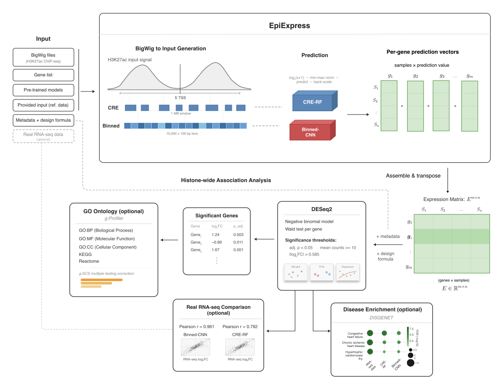

# HAWAS Pipeline

An automated Nextflow pipeline for model-based Histone-Wide Association Analysis (HAWAS) from H3K27ac ChIP-seq data.

## Table of Contents

- [Introduction](#introduction)
- [Pipeline Overview](#pipeline-overview)
- [Requirements](#requirements)
- [Installation](#installation)
- [Configuration](#configuration)
- [Usage](#usage)
- [Input Format](#input-format)
- [Output Structure](#output-structure)
- [Running Individual Scripts](#running-individual-scripts)
- [Issues](#issues)
- [Citation](#citation)

## Introduction

The EpiExpress HAWAS Pipeline takes H3K27ac ChIP-seq BigWig files as input and produces differential expression results from predicted gene expression, without any measured RNA-seq data. It first predicts gene expression with the pre-trained CRE-RF and Binned-CNN models from [EpiExpress](https://github.com/SchulzLab/EpiExpress), then runs DESeq2 on the predicted matrices across your sample groups. Optionally, real RNA-seq counts can be provided for a comparison of predicted versus measured fold changes, GO and pathway enrichment can be enabled, and DISGENET disease enrichment can be run across all three gene lists. 

## Pipeline Overview

1. **Setup**: The EpiExpress repository is cloned automatically from GitHub if `repo_dir` is not set in the config; otherwise the local path is used directly.
2. **Expression prediction**: Convert BigWig files to feature matrices and run CRE-RF and/or Binned-CNN predictions, producing one predicted expression value per gene per sample.
3. **Matrix assembly**: Merge per-gene CSVs into a single compressed genes x samples matrix for each model.
4. **Differential expression**: Run DESeq2 on the predicted expression matrix using the metadata and design formula you supply.
5. **Real RNA-seq comparison** *(optional)*: Run DESeq2 on a real RNA-seq count matrix with the same design and produce scatter plots of predicted versus measured log2 fold changes for significant genes. Triggered by setting `real_rna_matrix` in the config.
6. **GO enrichment** *(optional)*: Run g:Profiler on the up- and down-regulated significant genes from each model. Triggered by setting `run_go_enrichment: true` in the config.
7. **DISGENET disease enrichment** *(optional)*: Run Fisher's exact test on each model's significant gene list against curated disease gene sets and produce a bubble plot. Triggered by setting `disgenet_gmt` in the config. Requires that all three gene lists (CRE-RF, Binned-CNN, Real-RNA) are available, i.e. `mode` is `"all"` or `"CRE-RF,Binned-CNN"` and `real_rna_matrix` is set.



## Requirements

- [Nextflow](https://www.nextflow.io/) >= 23.04
- [Conda](https://docs.conda.io/) or [Mamba](https://mamba.readthedocs.io/) for environment management
- Git with submodule support
- Pre-trained models and supporting provided input files from Zenodo: [https://doi.org/10.5281/zenodo.13992024](https://doi.org/10.5281/zenodo.13992024)

Predicting expression for ~28,000 genes per sample is computationally intensive. An HPC cluster or a multi-core server with sufficient memory is strongly recommended. Running this on a laptop is not practical.

## Installation

```bash
# 1. Clone the repository together with the EpiExpress submodule (for parallel prediction)
git clone --recurse-submodules <repo-url>
cd epiexpress_hawas_pipeline

# 2. Create the two conda environments the pipeline requires
conda env create -f config/environment_epiexpress.yml
conda env create -f config/environment_hawas.yml

# 3. Download models and supporting input from Zenodo
#    https://doi.org/10.5281/zenodo.13992024
#    Download CRE_RF_models.tar and/or CNN_best_models.tar.gz and the ProvidedInput/ folder.
```

Nextflow activates the correct conda environment automatically for each process via `nextflow.config`. You do not need to activate any environment manually before running the pipeline.

## Configuration

The pipeline is configured through a JSON file with two top-level sections: `EpiExpress` (prediction settings) and `HAWAS` (differential analysis settings).

**JSON example:**

```json
{
  "EpiExpress": {
    "repo_dir": "null",
    "bigwigs": "/path/to/bigwig_files/",
    "mode": "CRE-RF",
    "out_folder": "./results",
    "gene_file": "/path/to/gene_list.txt",
    "cre_rf_model_folder": "/path/to/CRE_RF_models/",
    "binned_cnn_model_folder": "/path/to/CNN_best_models/",
    "provided_input": "/path/to/ProvidedInput/",
    "cores": 10,
    "correlation_cutoff": 0
  },
  "HAWAS": {
    "metadata_file": "/path/to/metadata.txt",
    "design_formula": "~ Sex + Factor",
    "metadata_sample_id": "SampleID",
    "real_rna_matrix": "/path/to/real_rna_counts.tsv",
    "run_go_enrichment": true,
    "disgenet_gmt": "/path/to/DGN_diseases_CURATED.gmt"
  }
}
```

This file is provided in `example_config.json`.

### EpiExpress parameters

| Parameter | Required | Description |
|-----------|----------|-------------|
| `repo_dir` | No | Path to a local EpiExpress clone; cloned automatically from GitHub if omitted |
| `bigwigs` | Yes | Path to a BigWig folder, a list of file paths, or a glob pattern (e.g. `"samples/*.bw"`) |
| `mode` | Yes | Which models to run: `"CRE-RF"`, `"Binned-CNN"`, `"all"`, or `"CRE-RF,Binned-CNN"` |
| `cre_rf_model_folder` | For CRE-RF | Path to the downloaded CRE-RF model directory |
| `binned_cnn_model_folder` | For Binned-CNN | Path to the downloaded Binned-CNN model directory |
| `provided_input` | Yes | Path to the `ProvidedInput/` folder from Zenodo |
| `gene_file` | No | File with Ensembl IDs (one per line) to restrict predictions; uses all ~28,000 trained genes if omitted |
| `out_folder` | Yes | Output directory for all results |
| `cores` | No | Number of CPU cores for parallelised steps (default: `1`) |
| `correlation_cutoff` | No | Minimum Pearson correlation of a model on held-out test data to include a gene (default: `0`) |

### HAWAS parameters

| Parameter | Required | Description |
|-----------|----------|-------------|
| `metadata_file` | Yes | TXT file with sample IDs and condition labels  |
| `design_formula` | Yes | DESeq2 design formula, e.g. `"~ Sex + Factor"` |
| `metadata_sample_id` | Yes | Column name in the metadata file that matches BigWig sample names |
| `real_rna_matrix` | No | Raw RNA-seq count matrix (genes x samples, tab- or comma-separated); omit if not available |
| `run_go_enrichment` | No | Set to `true` to run g:Profiler GO and pathway enrichment per model. Defaults to skipped if absent or `false`. |
| `disgenet_gmt` | No | Path to a DISGENET GMT file. If set, runs disease enrichment across CRE-RF, Binned-CNN, and Real-RNA gene lists. Requires both prediction models and `real_rna_matrix` to be available. |

## Usage

```bash
# Run with your config file
nextflow run main.nf -params-file your_config.json

# Resume a previously interrupted run (skips already completed steps)
nextflow run main.nf -params-file your_config.json -resume

```

The output directory is controlled by `out_folder` in the JSON config. If `out_folder` is not set, the pipeline falls back to the `--outdir` command-line flag, or `./results` if neither is provided. `out_folder` in the JSON always takes precedence over `--outdir`.

## Input Format

### BigWig files

H3K27ac ChIP-seq BigWig files in hg38 containing the fold-change over control signal. The sample name used throughout the pipeline is derived from the BigWig filename. 

### Metadata TXT

A tab-separated file with one row per sample. The column specified by `metadata_sample_id` must match the BigWig sample names exactly.

| SampleID | Factor | Sex |
|----------|--------|-----|
| SAMPLE01 | Control | female |
| SAMPLE02 | Treatment | male |
| SAMPLE03 | Control | female |

The last variable in the design formula is used as the grouping variable for DESeq2 contrasts and PCA colouring.

## Output Structure

The DESeq2 output directory name is derived from the design formula: the `~` and spaces are removed, and `+` is replaced by `_`. For example, `"~ Sex + Factor"` becomes `Sex_Factor`.

```
<out_folder>/
├── matrices/
│   ├── combined_matrix_CRE-RF.csv.gz
│   └── combined_matrix_Binned-CNN.csv.gz
└── <design_name>/
    ├── DESeq2_results/
    │   ├── CRE-RF/
    │   │   ├── deseq2_results.txt       (all genes, sorted by padj)
    │   │   ├── sig_genes.txt            (padj ≤ 0.05, |log2FC| ≥ 0.585, baseMean ≥ 10)
    │   │   ├── dispersion_plot.pdf
    │   │   ├── MA_plot.pdf
    │   │   └── PCA_plot.pdf
    │   ├── Binned-CNN/                  (same structure as CRE-RF)
    │   ├── Real-RNA/                    (if real_rna_matrix was provided)
    │   └── Comparison/                  (if real_rna_matrix was provided)
    │       ├── sig_genes_real.txt
    │       ├── scatter_real_vs_CRE_RF.pdf
    │       └── scatter_real_vs_Binned_CNN.pdf
    ├── GO_enrichment/                   (if run_go_enrichment: true)
    │   ├── CRE-RF/
    │   │   ├── up_enrichment.txt + .pdf
    │   │   └── down_enrichment.txt + .pdf
    │   └── Binned-CNN/
    └── disgenet/                        (if disgenet_gmt was provided)
        └── disgenet_enrichment_full_top_20.pdf
```

The significant gene threshold applied consistently across all analyses is: `padj ≤ 0.05`, `|log2FoldChange| ≥ 0.585`, and `baseMean ≥ 10`.

## Running Individual Scripts

All R scripts in `bin/` can be run standalone outside of Nextflow.

```bash
# DESeq2 on predicted expression matrices
Rscript bin/deseq2_analysis.R \
    --combined_matrix_rf matrices/combined_matrix_CRE-RF.csv.gz \
    --output_dir results/ \
    --metadata_file meta.tsv \
    --design_formula "~ Sex + Factor" \
    --metadata_sample_id SampleID
```
```bash
# GO enrichment (background gene list and a sig_genes.txt)
Rscript bin/go_enrichment_analysis.R \
    --background gene_list.txt \
    --deseq_results DESeq2_results/CRE-RF/sig_genes.txt
```
```bash
# Real RNA-seq comparison
Rscript bin/real_rna_comparison.R \
    --real_rna_matrix counts.tsv \
    --metadata_file meta.tsv \
    --design_formula "~ Sex + Factor" \
    --metadata_sample_id SampleID \
    --output_dir .
```
```bash
# DISGENET disease enrichment (requires all three sig_genes lists)
Rscript bin/disgenet.R \
    --gmt_file DGN_diseases_CURATED.gmt \
    --background gene_list.txt \
    --rf_genes DESeq2_results/CRE-RF/sig_genes.txt \
    --cnn_genes DESeq2_results/Binned-CNN/sig_genes.txt \
    --real_genes DESeq2_results/Real-RNA/sig_genes.txt
```

## Issues

If you encounter problems, please open an issue on GitHub.

## Citation

If you use this pipeline, please cite:

- Ardakani, F. B., Ashrafiyan, S., Rumpf, L., Hecker, D., & Schulz, M. H. (2025, May). Harnessing machine learning models for epigenome to transcriptome association studies. https://doi.org/10.1101/2025.05.09.653095
- **EpiExpress** (prediction models): https://github.com/SchulzLab/EpiExpress
- **Nextflow**: Di Tommaso P et al. Nextflow enables reproducible computational workflows. *Nature Biotechnology* 2017. https://doi.org/10.1038/nbt.3820
- **DESeq2**: Love MI, Anders S, Huber W. Moderated estimation of fold change and dispersion for RNA-seq data with DESeq2. *Genome Biology* 2014. https://doi.org/10.1186/s13059-014-0550-8
- **g:Profiler**: Raudvere U et al. g:Profiler: a web server for functional enrichment analysis and conversions of gene lists. *Nucleic Acids Research* 2019. https://doi.org/10.1093/nar/gkz369
- **DISGENET**: Piñero J et al. The DisGeNET knowledge platform for disease genomics: 2019 update. *Nucleic Acids Research* 2020. https://doi.org/10.1093/nar/gkz1021
